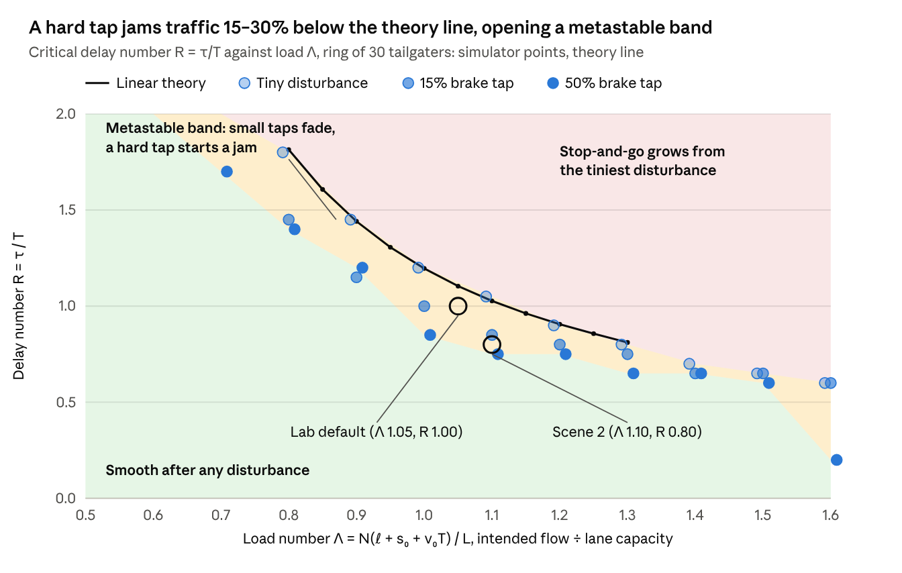

# The Jam Nobody Started

*The Ideas Behind Phantom Jam Lab*

Oct 26, 2026 · @Michael Thompson with Claude Code

## Prologue: A Ring of Twenty-Two Cars

In 2008, a team of physicists in Japan marked out a circle 230 metres around on open, level ground and put 22 cars on it. Each driver was asked to hold about 30 km/h and to follow the car ahead safely. For a while the cars moved like beads on a string. Then, with no accident, no lane closure and no one braking on purpose, a knot of cars slowed, stopped and pulled away again. The knot drifted backward around the ring, against the direction the cars were driving.

Yuki Sugiyama and colleagues published the film and their measurements as [experimental evidence that a jam can form with no bottleneck at all](https://doi.org/10.1088/1367-2630/10/3/033001). Traffic engineers call such a thing a phantom jam. A YouTube short, ["Why Do Phantom Traffic Jams Happen?"](https://www.youtube.com/shorts/jBTahEPAr-I), retells the story in under a minute. It ends with a suggestion: if a few drivers leave ample room ahead of them, the wave dies out.

This report is about that suggestion, and about the laboratory and the analysis built to test it.

### Two questions

The work set out to answer two questions.

1. **When does a crowded lane flow smoothly, and when does it break into stop-and-go?**
2. **How many drivers who leave ample room does it take to keep it smooth?**

The answers turned out to be compact. Whether a ring of cars flows smoothly depends mainly on two numbers, each the ratio of one rate to another. The first, the **load number Λ**, compares the flow of cars the drivers intend with the flow the lane can carry. The second, the **delay number R**, compares how long a driver takes to react with how closely they follow. Between smooth flow and certain jams lies a band where the road holds steady against small upsets but jams after a hard one. Low in that band, one driver in thirty who leaves ample room is enough to stop a jam. Near its upper edge and beyond, it takes one in six or more.

### Who built it

Phantom Jam Lab was built by Michael L. Thompson, a chemical engineer, working with Anthropic's Claude Code. The simulator came first, to let anyone watch the YouTube short's scenarios play out with any number of cars. The analysis came next, from a question a chemical engineer asks by habit: which ratios of rates govern this system? Engineers have answered that question for flows of fluid and heat for more than a century, with numbers such as the Reynolds number for a pipe and the Damköhler number for a reactor. This report asks it of a lane of traffic.

### How this report is built

- **Act I, The Wave**, follows seventy years of research into why traffic forms waves, and introduces the driver model the simulator uses.
- **Act II, The Lab**, describes the simulator: two rings side by side, tailgaters and drivers who leave ample room, and the scenes that show the difference.
- **Act III, Numbers Without Units**, applies Thomas Szirtes' method of dimensional analysis to find the ratios that govern the ring.
- **Act IV, The Map**, draws the boundary between smooth and stop-and-go traffic, first from theory and then from thousands of simulated runs.
- **Act V, Two Roads, One Answer**, tests the ratios the hard way: two different roads with the same ratios should behave the same.
- The **Epilogue** tells how the lab and the analysis were built and checked.

Technical terms are defined in the Glossary. The full derivation, with every matrix and table, is in the companion report, [Phantom Traffic Jams: A Szirtes Dimensional Analysis](https://claude.ai/artifact/Nid5md6VqM4DPfdRkrQWe7). The simulator itself is [Phantom Jam Lab](https://claude.ai/artifact/MHSiC7wxrhT9haM1Y5FpnF).

## Act I · The Wave

In the late 1950s, at General Motors' research laboratories in Michigan, two cars ran nose to tail around a test track. A thin wire ran from the lead car to the one behind, and instruments in the second car recorded the gap and how fast it was closing. The lead driver sped up and slowed down. The second driver followed as drivers do. The engineers wanted to know one thing: what, exactly, does a driver respond to?

### Stimulus and response

Robert Herman and colleagues gave the answer in 1958 ([Chandler, Herman and Montroll](https://doi.org/10.1287/opre.6.2.165)). A following driver accelerates in proportion to how fast the gap is opening or closing, and does so after a delay of a second or more. It was among the first car-following models fitted to measurements of real drivers.

A year later the same group asked what happens down a line of such drivers ([Herman, Montroll, Potts and Rothery, 1959](https://doi.org/10.1287/opre.7.1.86)). A slowdown at the front is passed back from car to car. Whether it shrinks or grows on the way depends on a single product: the driver's sensitivity multiplied by the reaction delay. Above one half, each driver brakes a little harder than the one ahead, and the slowdown grows as it travels. The idea that a line of cars can be stable or unstable as a *string*, quite apart from any one car, begins here. So does the idea that reaction delay, measured against some other time in the system, decides the matter. Act III finds the same idea in a modern form.

### Waves on long crowded roads

At the same time, two mathematicians in England looked at traffic from a distance, as a fluid. In 1955, M. J. Lighthill and G. B. Whitham treated cars as a continuous stream whose flow depends on its density ([Lighthill and Whitham](https://doi.org/10.1098/rspa.1955.0089)). Paul Richards reached the same picture independently the next year ([Richards, 1956](https://doi.org/10.1287/opre.4.1.42)). In their theory a change in density travels as a wave, and the front of a dense region can move backward along the road while every car in it moves forward. That is the backward-drifting knot the drivers on the Japanese ring saw.

The fluid picture explains how a jam moves. It does not explain why a jam forms where nothing blocks the road.

### A jam with no cause

That answer came in the 1990s. In 1993, Boris Kerner and Peter Konhäuser showed that in a range of densities, smooth traffic is *metastable* ([Kerner and Konhäuser](https://doi.org/10.1103/PhysRevE.48.R2335)). Small disturbances fade, but one large enough grows into a lasting cluster of slow cars. In 1995, Masako Bando and colleagues proposed a simple car-following rule, the optimal velocity model, in which uniform flow becomes unstable above a critical density and jams appear on their own ([Bando et al.](https://doi.org/10.1103/PhysRevE.51.1035)).

Thirteen years later, several of the same authors took the question off the computer and onto the ground. The 2008 ring experiment in the Prologue was their test, and the jam appeared as the theory said it would.

### The driver in the machine

The simulator needed a driver model that behaves sensibly on its own and goes wrong in the ways real drivers do. In 2000, Martin Treiber, Ansgar Hennecke and Dirk Helbing published the Intelligent Driver Model ([Treiber, Hennecke and Helbing](https://doi.org/10.1103/PhysRevE.62.1805)). Each driver has a desired speed, a preferred time gap to the car ahead, a minimum gap when stopped, a comfortable acceleration and a comfortable braking rate. The model never crashes, and with instant reactions it is stable at most densities.

In 2006, Treiber, Arne Kesting and Helbing added what real drivers bring to it: a reaction delay, errors in judging gaps and speeds, and the habit of guessing where the car ahead will be ([Treiber, Kesting and Helbing](https://doi.org/10.1016/j.physa.2005.05.001)). They called the result the Human Driver Model. Reaction delay makes the flow less stable. Looking ahead can make up for it.

Phantom Jam Lab gives its two kinds of driver different rules.

- **Tailgaters** follow the Human Driver Model. Each acts on the gap and closing speed it saw a reaction time ago, projected forward over that delay. A slowly wandering attention error, which the simulator calls *distraction*, adds to each driver's acceleration.
- **Drivers who leave ample room**, called *absorbers* in the code, do not chase the car ahead. They cruise at a running average of its speed over the last eight seconds, and correct only when the gap drifts outside a wide band. Their preferred following time is three seconds rather than one.

Every car also has an emergency reflex: if stopping safely behind the car ahead would take harder braking than a set limit, it brakes hard at once. That reflex plays a part in Act V.

### Where it lives in the lab

- **The driver rules:** `src/engine.js`, in the step that updates every car each 0.05 s.
- **The controls:** the Drivers panel sets the reaction time, both following times, the distraction level and the number of drivers who leave ample room. The Vehicles panel sets car length, the gap when stopped, acceleration and comfortable braking.

## Act II · The Lab

Open Phantom Jam Lab and two rings of thirty cars appear side by side, each about 900 metres around. The cars are small coloured shapes, green when they are moving freely and shading to red as they slow. The ring on the right, labelled \*Everyone tailgates\*, is just that. The ring on the left, labelled \*Your mix\*, has the same drivers, except that some of them leave ample room ahead. Four seconds in, the driver of car 1 on each ring taps the brakes, dropping to half speed for a moment. What happens next is the whole point of the lab.

### Side by side

The lab was built to make one comparison easy to see: the same road, the same tap, with and without drivers who leave room. Both rings run the same random seed, so any difference between them comes from the drivers and not from chance.

Under the rings, a time-space record traces every car's position over time. A stop-and-go wave shows on it as a red band sloping backward, the same backward drift Lighthill and Whitham predicted. A live readout compares the two rings over the last three minutes. Clicking any car opens its card, with its speed, its gap and its hard brakes, and two buttons: one taps its brakes, the other makes its driver leave room.

Every control the simulator uses is on the page, grouped in four panels.

| Panel | Controls |
| --- | --- |
| Traffic | cars, road length (one lap), speed limit |
| Drivers | reaction time, tailgater following time, ample following time, number of drivers who leave ample room and where they sit, distraction |
| Vehicles | car length, gap when stopped, acceleration, comfortable braking |
| Brake taps | tap size, random taps on or off, and how often they come |

Any control can be changed while the cars are running.

### The scenes

Six preset scenes walk through the YouTube short and beyond.

1. **One tap of the brakes.** Thirty tailgaters, one hard tap. The pulse travels backward and grows until cars far behind come to a full stop.
2. **One driver leaves room.** The same tap, on a road set to a knife edge. On the left, the driver just behind the tapper keeps a long gap, and the road settles within about 90 seconds at 64 km/h. On the right, cars keep grinding down to 0–25 km/h for the full five minutes.
3. **Everyone leaves room.** Each driver eases off less than the one ahead, and the tap shrinks to nothing within a few cars.
4. **The ring-road experiment.** Twenty-two cars on a 230-metre circle, after Sugiyama. Nobody brakes on purpose, yet a little distraction is enough to start a wave.
5. **Rush hour.** One hundred and fifty cars on a 4-kilometre loop with random taps, one driver in ten leaving room.
6. **Half and half.** Sixty cars, every other driver leaving room. Sliding the count down shows when the jams come back.

Scene 2 needed the most care. Its first version used the lab's default road, and one driver who left room made no visible difference. Act IV explains why, and how the analysis found the setting where one driver does.

### The idea in the field

The YouTube short's suggestion has been tested with real cars. In 2016, Raphael Stern and colleagues ran more than twenty vehicles around a ring track in Arizona, one of them an automated car under their control ([Stern et al., 2018](https://doi.org/10.1016/j.trc.2018.02.005)). Waves formed as they had in Japan. When the automated car began to drive smoothly, holding a steady speed near the average rather than chasing the car ahead, the waves were damped. The authors concluded that traffic could be steadied by "a few mobile actuators (less than 5%)". The lab's drivers who leave ample room follow the same idea, with a human doing the steering.

### Where it lives in the lab

- **The page:** `src/app.html`, built into a single file by `build.mjs` and published as [Phantom Jam Lab](https://claude.ai/artifact/MHSiC7wxrhT9haM1Y5FpnF).
- **The scenes:** the `SCENARIOS` list in `src/app.html`.
- **The two rings:** two copies of the engine in `src/engine.js`, one with the chosen drivers and one with every driver tailgating.

## Act III · Numbers Without Units

In 1914, a physicist at the National Bureau of Standards in Washington published a paper with a plain title, ["On Physically Similar Systems"](https://doi.org/10.1103/PhysRev.4.345). Edgar Buckingham's point was simple to state. A law of physics cannot depend on whether lengths are measured in feet or metres. So any such law can be rewritten as a relation among numbers that have no units at all, and the count of those numbers is fixed: the number of variables, less the number of independent units they are built from.

Engineers have lived by that result ever since. Whether flow in a pipe is smooth or turbulent depends on one such number, named for Osborne Reynolds: the pull of the fluid's momentum set against the drag of its viscosity. Whether a reactor's output is limited by its chemistry or by its plumbing depends on another, named for Gerhard Damköhler: the rate of reaction set against the rate of flow through the vessel. Each is a ratio of two rates of the same kind, and each splits a world of designs into regimes.

### The question

Michael Thompson asked whether the same could be done for a lane of traffic. The proposed first number was a ratio of car flows: the flow of cars the drivers intend, divided by the lane's carrying capacity at the speed they intend. If the drivers all drove at the speed limit, the intended flow would be the number of cars divided by the time one lap takes at that speed.

To answer it, the analysis followed the method in Thomas Szirtes' *[Applied Dimensional Analysis and Modeling](https://csc.knu.ua/media/study/asp/dsm_zhuk/book/book1.pdf)* (second edition, 2007). Szirtes turns Buckingham's theorem into a bookkeeping procedure. List every variable and its units in a matrix. Choose a few variables to serve as the system's own yardsticks. A single matrix formula then yields a complete set of unitless products, which Szirtes calls the *Dimensional Set*, and a check confirms that every product really is unitless. Later chapters give rules for dropping products that do not matter and for testing the result.

### Cars as a unit

The first choice was the unusual one. Alongside metres and seconds, the analysis counts cars as a unit of their own. Szirtes allows a new unit when it has a physical meaning, is used consistently and appears in at least two variables. Cars pass all three tests: they are conserved on a ring, they are counted the same way everywhere, and they appear in the number of cars, the car length per car, the following time per car and more.

The choice paid off at once. A driver's following time turns out to be measured in *seconds per car*: it is the time between successive cars passing a point. A driver's reaction time is plain seconds, because it belongs to one driver's nervous system and not to the stream. Dividing one by the other therefore needs a hidden constant, one car, which plays the part that Avogadro's number plays when chemists count molecules in moles. Every unitless product that needs that constant describes something handed from one car to the next. Every product that does not describes the stream as a smooth fluid. The units alone sort the physics into two families.

### Thirteen products, recast as rates

Sixteen variables built from three units give thirteen unitless products. The analysis chose the desired speed, the tailgater's following time and the single car as yardsticks, computed the products in exact fractions, and passed Szirtes' check. It then recombined them, as Szirtes permits, so that each one reads as one rate divided by another rate of the same kind.

Two of them carry most of the story.

```latex
\Lambda = \frac{\text{intended car flow}}{\text{lane capacity at } v_0} = \frac{N(\ell + s_0 + v_0 T)}{L}
```

```latex
R = \frac{\text{rate cars arrive behind a driver}}{\text{rate the driver updates}} = \frac{\tau}{T}
```

The **load number Λ** is Thompson's proposed group, exactly. A car at the speed limit occupies its own length, its stopped gap and its safety margin, and the lane can pass only so many such footprints per second. Below 1, everyone can drive at the limit; above 1, they cannot. The **delay number R** is reaction time over following time. It is the modern form of the 1959 General Motors product, and it needs the one-car constant, so it belongs to the car-to-car family.

The rest are listed below at the lab's default settings. In the app's terms, Λ is Cars × (6.5 m + Speed limit in m/s × Tailgater following time) ÷ Road length, and R is Reaction time ÷ Tailgater following time.

| Group | Ratio of rates | Chemical-engineering kin | Default |
| --- | --- | --- | --- |
| Λ, load number | intended car flow ÷ lane capacity | throughput over capacity, as in column flooding | 1.05 |
| R, delay number | arrivals behind a driver ÷ the driver's update rate | a Damköhler number dominated by lag | 1.0 |
| S | rate cars arrive ÷ rate a car regains speed | a Stokes or Deborah number | 20.8 |
| β | braking rate ÷ accelerating rate | unequal forward and reverse rate constants | 1.67 |
| M | backward speed of a jam front ÷ driving speed | a Mach number | 0.26 |
| ℓ/s₀ | car length ÷ stopped gap | an aspect ratio | 2.25 |
| N | cars on the ring | number of stages | 30 |
| Πₙ | rate distraction pumps in speed variance ÷ its scale | a Damköhler number for a source | 0 |
| φ | share of drivers who leave room | a mole fraction | 0 to 1 |
| Tₐ/T | ample following time ÷ tailgater following time | a buffer-tank capacity ratio | 3.0 |

The outcome the analysis tracks is the spread of car speeds once the ring has settled, divided by the desired speed. Smooth traffic has almost no spread; stop-and-go has a lot.

### Fewer numbers

Twelve governing numbers are far too many to map. Szirtes gives three ways to cut them down, and the analysis used all three.

- **Hold them fixed.** Several groups depend only on the kind of car and driver, and the lab's defaults keep them constant.
- **Fuse them.** The number of cars and the road length enter mainly through Λ.
- **Test them.** Each remaining group was varied while Λ and R were held, and the boundary between smooth and stop-and-go traffic was measured. Ring size mattered only slightly once the ring held 30 cars or more. Distraction mattered a great deal, even at small values, because it supplies a steady stream of small upsets.

One variable was missing from the first list: the size of the upset itself. A brake tap that drops one car's speed by some amount is a starting condition and not a property of the road, but it is still a physical quantity, and Act IV shows it matters. With it added, the outcome for a ring of tailgaters depends on four numbers: Λ, R, the tap size and the distraction level.

### Where it lives in the analysis

- **The Dimensional Set:** `analysis/dimensional-set.mjs` builds the matrix, computes the products in exact fractions and runs Szirtes' check.
- **The relevance tests:** `analysis/relevancy.mjs`.
- **The full derivation:** Steps 1 to 4 of the companion report.

## Act IV · The Map

The first clue came from the lab's first user. With the lab's first settings, the scene meant to show one driver leaving room looked almost the same on both rings: one hard tap, and both roads jammed. Was the YouTube short wrong, or was the lab? The answer turned out to be neither. The road was sitting in a particular place on a map nobody had yet drawn.

### A ripple passed car to car

The map's first line comes from theory. Picture a small, smooth ripple in speed, passed from one car to the next. Each driver passes it on a little changed, larger or smaller depending on how quickly it rises and falls. If any ripple comes out larger than it went in, it grows from car to car down the line, and the flow is *string unstable*. That is the 1959 General Motors idea, applied to the modern driver model.

Working it through for the lab's tailgaters gives a **critical delay number** for each load: the value of R above which some ripple grows. At the default load of 1.05 it is 1.10. Above it, the growth compounds quickly. At R = 1.2 each car enlarges the ripple by 8%, so after ten cars it is 2.2 times as large. At R = 1.4 each car enlarges it by a third, and after ten cars it is about 18 times as large. The busier the road, the quicker drivers must be: the critical value falls from 1.8 at a load of 0.8 to 0.81 at a load of 1.3.

### Thousands of rings

Theory speaks only of small ripples. To see what a real tap does, the analysis ran the simulator over a grid: twelve loads, thirty-three delay numbers and three sizes of upset, each run lasting 400 simulated seconds. Each run was scored smooth or stop-and-go by the spread of speeds over its last minute. Without distraction the outcome was never in doubt: the spread came out either tiny or large, with nothing in between.

For the smallest upsets, the simulator's boundary fell within 0.05 of the theory line at every load from 0.8 to 1.3. For a hard tap to half speed, it fell 15 to 30% lower.



*Chart source: `report/regime-chart.jsx`, generated by `report/regime-chart.mjs`. Data: analysis/regime-sweep.mjs and analysis/linear-stability.mjs · 12 loads × 33 delay numbers × 3 upset sizes, 400 s runs.*

Above the lighter dots, even the smallest ripple grows into stop-and-go. Below the darkest dots, the ring recovers from anything. The shaded band between them is where the size of the upset decides.

### The metastable band

Between the two lines lies a band where the flow is stable against small upsets and unstable against large ones. Kerner and Konhäuser had predicted such a band in 1993; here it is, measured. A chemical engineer knows the shape well: a reactor that is stable at its operating point but can be pushed by a large enough upset onto a hotter, runaway branch, where it stays.

The lab's default road, at a load of 1.05 and a delay number of 1.0, sits inside that band. That explains what the first user saw. A hard tap jams the default road, and at R = 1.0 it takes five drivers who leave room, not one, to prevent it.

### The price of a smooth road

How many drivers who leave room does a road need? The answer depends on which side of the theory line it sits. At the default load, the analysis added such drivers one at a time, evenly spaced, until the ring stayed smooth after a hard tap.

| Delay number R | Drivers who leave room, out of 30 | Share |
| --- | --- | --- |
| 0.8 | none needed | 0% |
| 0.9 | 1 | 3% |
| 1.0 | 5 | 17% |
| 1.1 | 5 | 17% |
| 1.2 | 6 | 20% |
| 1.4 | 10 | 33% |

Inside the band, the tailgaters damp small ripples on their own, so a driver who leaves room has only to absorb the one large tap. Low in the band, where the road only just jams, one such driver does it. Nearer the theory line the tap grows faster on its way back, and it takes five. Past the theory line, every tailgater enlarges ripples, and the drivers who leave room must sit close enough together to catch them before they grow.

The gain is smoothness more than speed. Drivers who leave room take up road, so a smooth ring that includes them averages about 55 km/h, while a smooth ring of tailgaters manages 68 km/h. But a jammed ring of tailgaters averages 39 to 64 km/h and brakes hard several times a minute, and the drivers who leave room remove almost all of that braking.

### Scene 2, moved into the band

With the map in hand, the scene could be placed with care. Scene 2 now uses a reaction time of 0.8 s and a 860-metre lap, which puts it at a load of 1.10 and a delay number of 0.80, inside the band and close to its lower edge. There, one driver who leaves room behind the tapper turns a five-minute jam into a road that settles within about 90 seconds.

The band also explains why the scene is a knife edge. Across ten random starts at a load of 1.05 and R = 0.8, one driver turned a jam into smooth flow in three, both rings stayed smooth in five, and both jammed in two. That spread is what metastability looks like.

### The map in the lab

The lab now draws this map live, in a Regime map panel under the time-space record. A dot marks where the current road sits. The theory line is recomputed whenever the speed limit or the vehicle settings change, and the measured hard-tap line is shown when the vehicles are near the defaults. Clicking anywhere on the map moves the road there, by setting the road length and the reaction time.

### Where it lives in the analysis

- **The theory line:** `analysis/linear-stability.mjs`.
- **The simulated map:** `analysis/regime-sweep.mjs`, results in `analysis/results/regime.json`.
- **The cost of a smooth road:** `analysis/absorber-sweep.mjs`.
- **The panel:** the Regime map section of `src/app.html`.

## Act V · Two Roads, One Answer

In the 1870s, William Froude towed small wooden hulls along a long indoor tank on the English coast and measured how hard the water pulled on them. From those models Froude predicted the resistance of warships many times their size. The method worked because model and ship were matched in the right ratio, the one now named for Froude. Matched ratios, matched behaviour: that is the test every dimensional analysis must finally pass.

### The rule

Szirtes states it as a rule of similarity. If two systems have the same values of every governing number, they must have the same outcome, however different they are in metres and seconds. For the lab, that means a road of trucks and a road of cars, built so that every number in Act III matches, should jam at the same delay number.

The test had a precondition. A simulator can quietly break similarity if it holds a constant in fixed units, such as a braking limit in metres per second squared, that the analysis never listed. The engine had several: the thresholds of the emergency reflex, the limits on braking and acceleration, the rate and length of a brake tap, the gains of the drivers who leave room, and the time step itself. Each was rewritten as a multiple of a length unit and a time unit, both 1 by default. At the default settings the rewritten engine reproduces the old one bit for bit.

### Two roads

Road A is the lab's car highway. Road B is a truck road built from it by stretching every length by 4/3 and every time by 1.5.

| Quantity | Road A, cars | Road B, trucks |
| --- | --- | --- |
| speed limit | 90 km/h | 80 km/h |
| following time | 1.0 s | 1.5 s |
| vehicle length | 4.5 m | 6.0 m |
| gap when stopped | 2.0 m | 2.67 m |
| acceleration | 1.2 m/s² | 0.71 m/s² |
| comfortable braking | 2.0 m/s² | 1.19 m/s² |
| road length at a load of 1.05 | 900 m | 1200 m |
| ample following time | 3.0 s | 4.5 s |

Every entry differs. Every governing number is the same.

### What the test found

**The engine holds no stray constant.** A scale model with lengths doubled and times quadrupled keeps every step of the computer's arithmetic exact. It reproduced Road A bit for bit in four cases: a jam, five drivers who leave room, heavy distraction, and random taps. The lab's test suite now checks this on every run.

**The numbers predict where jams start.** For small upsets and for taps of 15%, the truck road jammed at the same delay number as the car road, within one step of the 0.025 grid, at loads of 0.9, 1.05 and 1.2. In linear theory the two roads agree exactly.

**A number was missing.** After a hard tap to half speed, the trucks held out to R = 0.925, while the cars jammed from 0.775. Scaling the engine's hidden constants one at a time found the cause. Scaling only the braking and acceleration limits brought the trucks back to 0.80, beside the cars. The ratio of the emergency braking limit to comfortable braking is therefore a governing number in its own right: 4.5 for the cars, 7.6 for these trucks. It acts only in hard braking, so it matters only after large upsets, which is why the first list did not need it. Real trucks brake less hard in an emergency than cars do, which would pull their ratio back toward the cars' value.

**Acceleration matters for large upsets.** A control road that changed only S, how quickly a car regains speed relative to how often cars arrive, moved the theory line by less than 0.01. After a tap, it moved the simulator's boundary by as much as 0.35. Sweeping the vehicle numbers one at a time told the same story. Quicker acceleration lowers the critical delay number, stronger braking raises it, and the ratio of car length to stopped gap matters little. In every sweep the hard-tap boundary sat 0.14 to 0.37 below the theory line, so the metastable band belongs to the driver model and not to one choice of vehicle.

### Where it lives in the analysis

- **The similarity test:** `analysis/similarity.mjs`, results in `analysis/results/similarity.json`.
- **The vehicle sweeps:** `analysis/pi-sweep.mjs`.
- **The scale-model check:** `test/engine.test.mjs`, run by `npm test`.

## Epilogue: How This Was Built

The lab began as a single request: a simulation that would let someone watch the YouTube short's scenarios with any number of cars, and any number of them leaving ample room. Everything in Acts III to V grew from questions asked while watching it. The lab and the analysis were built with Claude Code, Anthropic's coding agent, working with Michael Thompson in October 2026. A few habits kept the two honest with each other.

### The habits

**One engine.** The page and the analysis scripts run the same file, `src/engine.js`. The scripts load it directly rather than keeping a copy, so every number in this report comes from the code that draws the cars on screen.

**A fingerprint before every change.** Before the engine was reworked for the similarity test, a short script recorded its exact output for a set of scenes. After the change, the output was compared bit for bit. A change that was meant to alter nothing was required to alter nothing.

**Tests that state claims.** The test suite reads as a list of claims about traffic, each checked on every run. Cars never overlap. Tailgaters turn a tap into a standstill further back. When everyone leaves room, the same tap fades. The Sugiyama ring jams from driver noise alone. A scale model with lengths doubled and times quadrupled evolves bit for bit like the original. In scene 2, one driver who leaves room keeps the road from jamming.

**A browser in the loop.** Changes to the page were checked in a real browser, driven by a script: it loaded the built page, ran scenes, moved controls while the cars were running, and saved screenshots to look at.

**Everything reruns.** One command, `npm run analysis`, regenerates every result in this report from scratch in a few minutes, on any computer with Node.js and no other software.

### A short retrospective

Three things went wrong along the way, and each was caught by one of those habits.

- The first scaling of the distraction setting used the wrong power of time. The similarity test exposed it, because the two roads disagreed until it was fixed.
- An early suggestion for scene 2, a delay number of 0.9, did not work at the lab's three-second ample following time. Running the scene showed that one driver was no longer enough there, and the scene moved to 0.8.
- After the similarity rework, moving a control while the cars were running made the left ring show "NaN", not a number. The page was replacing the engine's settings without the new length and time units. The engine now fills in its own defaults whenever its settings change, and a test holds it to that.

### What it adds up to

The YouTube short's claim holds, with a condition attached. A driver who leaves ample room can stop a phantom jam, and on a road low in the metastable band one such driver in thirty is enough. Nearer the theory line and past it, the road needs five or more. Two ratios of rates, the load number and the delay number, say which kind of road you are on. They came out of the same method a chemical engineer would bring to a reactor or a pipe.

## Glossary

- **Absorber.** The code's name for a driver who leaves ample room. It cruises at the average speed of the car ahead and lets the gap stretch and shrink, rather than braking with every change.
- **Critical delay number.** The delay number above which a small ripple in speed grows from car to car. It depends on the load number: 1.10 at the lab's default load of 1.05.
- **Damköhler number.** In chemical engineering, the rate of a reaction divided by the rate at which flow carries material through the vessel.
- **Delay number (R).** A driver's reaction time divided by their following time. In the app: Reaction time ÷ Tailgater following time.
- **Dimensional Set.** Szirtes' table that turns a list of variables and their units into a complete set of unitless products, with a built-in check.
- **Distraction.** The lab's slowly wandering error in each driver's acceleration, standing in for lapses of attention.
- **Emergency braking ratio.** The hardest braking a vehicle will use divided by its comfortable braking. Act V found it governs what happens after a hard tap.
- **Following time.** The time between your car and the one ahead passing the same point; also called time headway. One second for the lab's tailgaters, three for its drivers who leave room.
- **Human Driver Model.** The Intelligent Driver Model with a reaction delay, estimation errors and anticipation added (Treiber, Kesting and Helbing, 2006). The lab's tailgaters follow it.
- **Intelligent Driver Model.** A car-following rule built from a desired speed, a preferred following time, a stopped gap, and comfortable acceleration and braking (Treiber, Hennecke and Helbing, 2000).
- **Kinematic wave.** A change in traffic density that travels along the road at its own speed, often backward relative to the cars (Lighthill and Whitham, 1955; Richards, 1956).
- **Load number (Λ).** The flow of cars the drivers intend divided by the flow the lane can carry at that speed. In the app: Cars × (car length + gap when stopped + speed limit × tailgater following time) ÷ Road length.
- **Metastable.** Stable against small upsets but not against large ones. In the metastable band, a hard tap can start a jam that a light one cannot.
- **Phantom jam.** A stop-and-go wave that forms with no accident, merge or lane closure to cause it.
- **Regime map.** A chart of the delay number against the load number, divided into smooth, metastable and stop-and-go regions. The lab draws it live.
- **Reynolds number.** In fluid flow, the fluid's momentum divided by its viscous drag; it decides whether flow in a pipe is smooth or turbulent.
- **Similarity.** The rule that two systems with the same governing numbers have the same outcome, whatever their size or speed.
- **Speed spread.** The standard deviation of car speeds once the ring has settled, divided by the desired speed. The analysis scores a run as smooth when it is below 0.1.
- **String stability.** A line of vehicles is string stable when a change in speed at the front shrinks, rather than grows, as it is passed back car by car.
- **Time-space record.** A chart of every car's position against time. A jam shows as a band sloping backward.

## Sources

Each journal entry was checked against its Crossref record; the arXiv record was used for Stern et al.

- Bando, M., Hasebe, K., Nakayama, A., Shibata, A., & Sugiyama, Y. (1995). Dynamical model of traffic congestion and numerical simulation. *Physical Review E, 51*(2), 1035–1042. <https://doi.org/10.1103/PhysRevE.51.1035>
- Buckingham, E. (1914). On physically similar systems; illustrations of the use of dimensional equations. *Physical Review, 4*(4), 345–376. <https://doi.org/10.1103/PhysRev.4.345>
- Chandler, R. E., Herman, R., & Montroll, E. W. (1958). Traffic dynamics: Studies in car following. *Operations Research, 6*(2), 165–184. <https://doi.org/10.1287/opre.6.2.165>
- Herman, R., Montroll, E. W., Potts, R. B., & Rothery, R. W. (1959). Traffic dynamics: Analysis of stability in car following. *Operations Research, 7*(1), 86–106. <https://doi.org/10.1287/opre.7.1.86>
- Kerner, B. S., & Konhäuser, P. (1993). Cluster effect in initially homogeneous traffic flow. *Physical Review E, 48*(4), R2335–R2338. <https://doi.org/10.1103/PhysRevE.48.R2335>
- Lighthill, M. J., & Whitham, G. B. (1955). On kinematic waves II. A theory of traffic flow on long crowded roads. *Proceedings of the Royal Society of London. Series A, 229*(1178), 317–345. <https://doi.org/10.1098/rspa.1955.0089>
- Richards, P. I. (1956). Shock waves on the highway. *Operations Research, 4*(1), 42–51. <https://doi.org/10.1287/opre.4.1.42>
- Stern, R. E., Cui, S., Delle Monache, M. L., Bhadani, R., Bunting, M., Churchill, M., Hamilton, N., Haulcy, R., Pohlmann, H., Wu, F., Piccoli, B., Seibold, B., Sprinkle, J., & Work, D. B. (2018). Dissipation of stop-and-go waves via control of autonomous vehicles: Field experiments. *Transportation Research Part C: Emerging Technologies, 89*, 205–221. <https://doi.org/10.1016/j.trc.2018.02.005>
- Sugiyama, Y., Fukui, M., Kikuchi, M., Hasebe, K., Nakayama, A., Nishinari, K., Tadaki, S., & Yukawa, S. (2008). Traffic jams without bottlenecks: Experimental evidence for the physical mechanism of the formation of a jam. *New Journal of Physics, 10*(3), 033001. <https://doi.org/10.1088/1367-2630/10/3/033001>
- Szirtes, T. (2007). *Applied dimensional analysis and modeling* (2nd ed.). Butterworth-Heinemann. <https://csc.knu.ua/media/study/asp/dsm_zhuk/book/book1.pdf>
- Treiber, M., Hennecke, A., & Helbing, D. (2000). Congested traffic states in empirical observations and microscopic simulations. *Physical Review E, 62*(2), 1805–1824. <https://doi.org/10.1103/PhysRevE.62.1805>
- Treiber, M., Kesting, A., & Helbing, D. (2006). Delays, inaccuracies and anticipation in microscopic traffic models. *Physica A, 360*(1), 71–88. <https://doi.org/10.1016/j.physa.2005.05.001>
- "Why Do Phantom Traffic Jams Happen?" \[Video\]. YouTube Shorts. <https://www.youtube.com/shorts/jBTahEPAr-I>

**Companion work**

- Phantom Jam Lab (simulator): <https://claude.ai/artifact/MHSiC7wxrhT9haM1Y5FpnF>
- Phantom Traffic Jams: A Szirtes Dimensional Analysis (technical report): <https://claude.ai/artifact/Nid5md6VqM4DPfdRkrQWe7>
